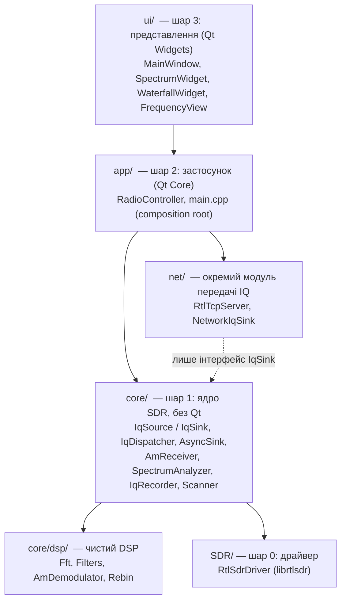

# Архітектура AM_RADIO_QT

Застосунок побудований як **конвеєр IQ-даних у шарах**. Кожен шар залежить лише від нижчих,
а розширюється через два інтерфейси: `IqSource` (звідки беруться дані) і `IqSink` (хто їх споживає).

## Шари



| Шар | Бібліотека CMake | Залежності | Відповідальність |
|---|---|---|---|
| 0 `SDR/` | `rtlsdr_driver` | librtlsdr | доступ до донгла, нічого не знає про застосунок |
| 1 `core/dsp/` | `radio_dsp` | лише STL (FFTW за наявності) | математика: FFT, FIR, децимація, АМ-детектор, перерахунок спектра в пікселі |
| 1 `core/` | `radio_core` | dsp, драйвер, libpulse | конвеєр IQ, джерела, споживачі, сканер; **без Qt** |
| 1 `net/` | `iq_net` | POSIX-сокети | сервер rtl_tcp; з ядром торкається лише через `IqSink` |
| 2 `app/` | у `am_radio` | Qt Core | збирає конвеєр, режими, потоки ↔ Qt-сигнали |
| 3 `ui/` | у `am_radio` | Qt Widgets | лише відображення і введення, жодної радіологіки |

Ядро і мережевий модуль не залежать від Qt: їх можна використати в консольній програмі
(сервер на Пі без GUI) і тестувати без дисплея (`tests/core_tests.cpp`).

## Потік даних

```
                    ┌──────────────────────────────────────────────────────────────┐
 RtlSdrSource ──┐   │ IqDispatcher (fan-out)                                       │
  або           ├──►│  ├─► AsyncSink ─► SpectrumAnalyzer ─► SpectrumFrame ─► UI    │ спектр + водоспад
 FileSource  ───┘   │  ├─► AsyncSink ─► AmReceiver ─► AudioOutput ─► PulseAudio/SSH│ звук
                    │  ├─► AsyncSink ─► IqRecorder ─► .sigmf-data/.sigmf-meta      │ запис (за потреби)
                    │  └─► NetworkIqSink ─► RtlTcpServer ─► TCP-клієнти            │ мережа (за потреби)
                    └──────────────────────────────────────────────────────────────┘
 Scanner (панорама) ── напряму через драйвер, коли потік зупинено ─► ScanResult ─► UI
```

* **`IqBlock`** — одиниця даних: сирі `cu8` байти донгла + ті самі семпли як `complex<float>`,
  частота центру, частота дискретизації, номер першого семпла, час. Блок незмінний
  і спільний для всіх споживачів (`shared_ptr<const IqBlock>`), нічого не копіюється.
* Перебудова частоти видна споживачам як зміна `centerHz`, втрата даних — як стрибок `firstSample`.
  Тому, наприклад, рекордер сам позначає пропуски в метаданих, без окремого API.
* Споживач, якому потрібен час (аналізатор, приймач, рекордер), загорнутий в **`AsyncSink`**:
  власний потік і обмежена черга. USB-потік лише кладе блок у чергу й ніколи не чекає;
  при перевантаженні викидаються найстаріші блоки (і це рахується).
* **Мережевий модуль** відокремлений архітектурно: `RtlTcpServer` нічого не знає про ядро,
  а адаптер `NetworkIqSink` (5 рядків) підключає його до конвеєра як звичайного споживача.
  Інший транспорт (UDP, ZeroMQ, SpyServer) додається так само — новим `IqSink`.

## Потоки

| Потік | Хто | Що робить |
|---|---|---|
| GUI | Qt | віджети, `RadioController` (усі публічні методи викликаються звідси) |
| USB | librtlsdr | приймає буфери, створює `IqBlock`, роздає диспетчеру |
| analyzer / receiver / recorder | `AsyncSink` | обробка блоків кожним споживачем окремо |
| audio | `AudioOutput` | віддає PCM у PulseAudio або stdout, буфер від джитера |
| rtl_tcp | `RtlTcpServer` | `poll()`: приймає клієнтів, шле дані, читає команди |
| sweep | `RadioController` | панорама (перебудова донгла), лише коли живий потік зупинено |

З робочих потоків у GUI дані йдуть лише через `QMetaObject::invokeMethod(..., Qt::QueuedConnection)`.
Якщо GUI не встигає (наприклад, X11 через SSH), зайві лінії спектра пропускаються
(`maxFramesInFlight`), а не накопичуються.

## Режими

* **Живий огляд** — безперервний захоплення вікна шириною 288 кГц … 2.4 МГц (частота дискретизації донгла).
  Працюють спектр, водоспад, приймач (будь-яка частота всередині вікна, без перебудови),
  запис і мережа одночасно.
* **Панорама** — діапазон будь-якої ширини (наприклад, 2–30 МГц): донгл перебудовується
  по вікнах 2.048 МГц з перекриттям, з них зшивається один спектр; кожен прохід = рядок водоспаду.
  Звук і запис недоступні (донгл стрибає по частотах).

## «Вся енергія» у спектрі і водоспаді

1. **Час:** кожен семпл бере участь в аналізі. Вікно Blackman-Harris з перекриттям 75 %
   (сума перекритих вікон майже стала), усі FFT-кадри між двома лініями водоспаду усереднюються.
   Тест: короткий імпульс 0.2 мс у будь-якому місці зберігає енергію з похибкою < 0.3 дБ.
2. **Масштаб:** нормування за Парсевалем — сума бінів дорівнює потужності сигналу,
   тож широкосмугові сигнали показані з повною енергією, а не лише піковим біном.
3. **Пікселі:** `dsp::rebinPower` віддає кожному пікселю **суму** потужності його смуги частот
   (біни на межі діляться пропорційно). Жодна несуча не зникає при стисненні
   (тест: 1 бін із 100000 видно при стисненні 250:1). Вісь — «дБFS у смузі пікселя»,
   фактична роздільна здатність підписана на графіку.
4. **Частота:** у панорамі DC-пік і краї кожного вікна закриваються сусіднім вікном —
   у зшитому спектрі немає дірок (перевіряє `tests/live_test.cpp`).
5. **Кольори водоспаду:** шкала автоматично від рівня шуму до найсильнішого сигналу + запас,
   сильні сигнали не впираються в білий.

## Як розширювати

| Завдання | Що додати |
|---|---|
| Інший демодулятор (FM, SSB) | клас-`IqSink` у `core/`, підключити в `RadioController` |
| Інший мережевий протокол | новий сервер у `net/` + адаптер-`IqSink` |
| Інше залізо (Airspy, HackRF) | реалізація `IqSource` |
| Консольний сервер без GUI | `RtlSdrSource` + `IqDispatcher` + `NetworkIqSink`, без Qt |

## Тести

* `build/core_tests` — без донгла: енергія FFT і перерахунку в пікселі, покриття в часі,
  АМ-демодулятор на 5 частотах дискретизації, черги, рекордер SigMF, rtl_tcp через localhost.
* `build/live_test [кГц]` — з донглом: живий огляд + приймач + запис + rtl_tcp-клієнт одночасно,
  панорама без дірок, відтворення запису через той самий конвеєр.
